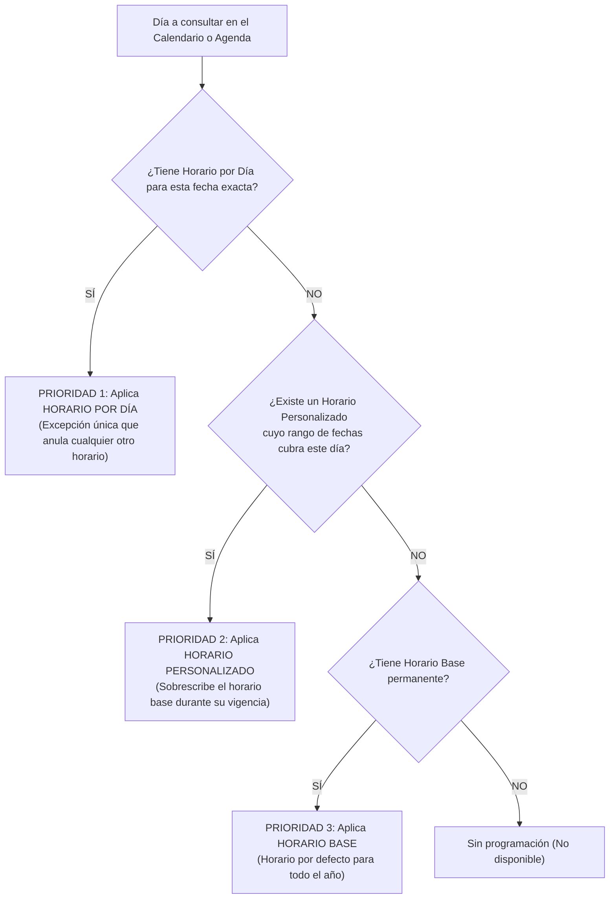

# Manual de Usuario y Guía Operativa: TEKER Medical Suite
## Módulo de Horarios, Franjas de Atención, Ausencias y Tiempos de Consulta

---

## Control de Versiones del Documento
| Versión | Fecha | Funcionalidad / Cambio | Perfil / Rol Destino |
| :--- | :--- | :--- | :--- |
| **1.2.0** | 2026-10-20 | Inclusión de **Horario por Día**, regla de prelación/prioridad de 3 niveles, toggle de fecha única, validación de festivos/domingos, modal interactivo de ayuda y estandarización de mensajes de Sistema. | Médicos, Coordinadores Médicos, Administradores, Recepcionistas |
| **1.1.0** | 2026-10-15 | Incorporación de Franjas de Atención por Rango de Fechas y Tiempos de Atención por Tipo de Aseguramiento. | Coordinadores Médicos, Administradores |
| **1.0.0** | 2026-10-01 | Creación inicial: Horarios Base, Horarios Personalizados, Gestión de Ausencias y Calendario Mensual. | Personal Asistencial y Administrativo |

---

## 1. Introducción y Objetivo del Módulo
El módulo **Horarios de Profesionales** de TEKER Medical Suite es la herramienta centralizada para programar, personalizar y supervisar la disponibilidad de los profesionales de la salud.

### Beneficios Principales:
- **Flexibilidad Total:** Permite definir horarios permanentes, horarios especiales para temporadas o rangos de fechas, e incluso **horarios excepcionales para un único día específico**.
- **Prevención de Conflictos:** El sistema valida automáticamente traslapes y solapamientos de horas, garantizando una agenda limpia y sin errores de citación.
- **Jerarquía Inteligente:** Resuelve de manera automática qué horario rige en cada fecha del año mediante un orden de prioridad claro y transparente.
- **Gestión Integral:** Centraliza en una sola vista los horarios laborales, las franjas de tipo de aseguramiento (Voluntario, Obligatorio, Giris), las ausencias programadas y los tiempos de atención requeridos por paciente.

---

## 2. Requisitos Previos y Acceso
- **Perfiles con Acceso:** Administrador de Sede, Coordinador Médico, Personal de Admisiones / Citas, y Profesionales de la Salud (según permisos asignados).
- **Navegadores Compatibles:** Google Chrome, Microsoft Edge, Mozilla Firefox, Safari (versiones actualizadas).
- **Requisito Operativo:** Seleccionar el profesional deseado en la barra superior antes de configurar turnos o consultar la agenda.

---

## 3. Mapa y Distribución de la Interfaz

La pantalla principal se encuentra dividida en 4 zonas funcionales:

```
+-----------------------------------------------------------------------------------+
|  [TK] TEKER Medical Suite                  [? Guía y Ayuda] [Modo Claro] [Refrescar]|
+-----------------------------------------------------------------------------------+
|  ZONA 1: Selector de Profesional  [Buscar por Nombre o Especialidad... ▾]          |
|          Foto, Nombre, ID, Estado y Switch [Trabaja Domingos y Festivos: SÍ / NO] |
+-----------------------------------------------------------------------------------+
|  Vigencias Registradas: [Lista colapsable de horarios guardados en el Sistema]    |
+-----------------------------------------------------------------------------------+
|  PESTAÑAS: [ Horario Profesional ] [ Franjas ] [ Ausencias ] [ Calendario ] [ Tiempos ] |
+-----------------------------------------------------------------------------------+
|  ZONA 2: Formulario de Configuración (según pestaña activa)                       |
|          Paso 1: Vigencia / Toggle "Horario por día"                              |
|          Paso 2: Días de la semana y rangos de hora                               |
|          Paso 3: Botón [Guardar en el Sistema]                                    |
+-----------------------------------------------------------------------------------+
```

---

## 4. Los 3 Tipos de Horarios y su Jerarquía de Prioridad

Para que la agenda médica responda con precisión a la realidad de la operación clínica, el sistema maneja **tres niveles de horarios**:



### Tabla Comparativa de Tipos de Horarios

| Tipo de Horario | Definición y Fechas | Prioridad | Cuándo Utilizarlo |
| :--- | :--- | :---: | :--- |
| **1. Horario por Día** | `Fecha Inicial = Fecha Final` (Un solo día). | **1 (Máxima)** | **Casos especiales o imprevistos de un día específico:** cuando el profesional viene a cubrir turnos extras, atiende en un día festivo especial, o en un día particular debe salir más temprano o cambiar su jornada habitual. |
| **2. Horario Personalizado** | Rango de fechas con inicio y fin definido (`Fecha Inicial <> Fecha Final`). | **2 (Media)** | **Períodos temporales delimitados:** jornadas de vacaciones de verano, reemplazos por 2 semanas, convenios de 3 meses o campañas de salud con horario especial. |
| **3. Horario Base** | Fecha inicial obligatoria y `Fecha Final Vacía (Indefinida)`. | **3 (Base / Por Defecto)** | **Jornada ordinaria permanente:** el horario estándar que el médico cumple habitualmente semana a semana a lo largo del año. Solo se permite un Horario Base por profesional. |

> [!IMPORTANT]
> **Regla de Oro de Prioridad:** El **Horario por Día** siempre gana sobre el Horario Personalizado y sobre el Horario Base. Si un médico tiene horario base los lunes de 08:00 a 12:00, pero para el próximo lunes se le crea un **Horario por Día** de 14:00 a 19:00, ese lunes específico el sistema abrirá citas de 14:00 a 19:00, sin afectar a los demás lunes del año.

---

## 5. Guía Paso a Paso de Operaciones

### 5.1. Selección del Profesional y Configuración de Festivos
1. En la parte superior, haga clic en el buscador de profesionales.
2. Escriba el nombre, apellido o especialidad del médico.
3. Al seleccionarlo, la tarjeta mostrará su fotografía, nombre completo y el interruptor **"Trabaja Domingos y Festivos"**:
   - **Activo (Verde):** El profesional puede tener turnos programados los días domingos y festivos nacionales.
   - **Inactivo (Gris):** El profesional no labora domingos ni días feriados.
4. **Si desactiva esta opción teniendo horarios previos registrados en domingo:** El sistema le mostrará un modal de advertencia indicando cuántos turnos existen y solicitando su confirmación para eliminarlos de manera segura.

---

### 5.2. Cómo Crear un "Horario por Día" (Fecha Única)
1. Ingrese a la pestaña **Horario Profesional**.
2. En el **Paso 1 (Escoger Rango de Vigencia)**, active el interruptor **"Horario por día (Aplica solo para un día específico)"**.
3. El formulario se adaptará automáticamente mostrando **un único campo de fecha**.
4. Seleccione en el calendario el día exacto deseado (ejemplo: `2026-11-15`).
5. Observe que en el **Paso 2**, el sistema detectará el día de la semana correspondiente (por ejemplo: *Domingo*) y:
   - **Habilitará únicamente ese día de la semana.**
   - **Bloqueará automáticamente todos los demás días** marcándolos con la leyenda *"No aplica para horario de un solo día"*.
6. Ingrese las horas de inicio y fin del turno (ejemplo: `08:00` a `13:00`). Puede añadir más turnos para ese día si tiene jornada partida con el botón `+ Agregar Turno`.
7. Haga clic en **Guardar Horarios**.

> [!WARNING]
> **Advertencia de Festivo / Domingo en Horario por Día:**
> Si el día seleccionado es un domingo o un festivo oficial nacional, y el médico tiene configurado que **NO trabaja domingos y festivos**, el sistema desplegará un modal de advertencia preventiva antes de guardar. Podrá revisar la advertencia y confirmar si desea continuar de manera excepcional o cancelar.

---

### 5.3. Cómo Crear un Horario Personalizado (Rango de Fechas)
1. Asegúrese de que el interruptor *"Horario por día"* esté **apagado**.
2. En **Fecha Inicial**, seleccione el día en que empieza a regir el horario.
3. En **Fecha Final**, seleccione el día en que culmina la vigencia.
4. En el **Paso 2**, configure los horarios para cada día de la semana (Lunes a Sábado/Domingo).
5. Utilice el botón **"Replicar Lunes a Viernes"** si el médico maneja la misma jornada de lunes a viernes para ahorrar tiempo.
6. Haga clic en **Guardar Horarios**.

---

### 5.4. Cómo Crear o Actualizar el Horario Base (Permanente)
1. Apague el interruptor *"Horario por día"*.
2. Ingrese la **Fecha Inicial** a partir de la cual entra en vigencia.
3. Deje el campo **Fecha Final en blanco**.
4. Configure los turnos semanales habituales.
5. Guarde los horarios. Este horario regirá de forma indefinida para todas las semanas donde no existan horarios personalizados o por día.

---

### 5.5. Consulta y Uso del Calendario Interactivo
1. Diríjase a la pestaña **Calendario**.
2. Verá el mes completo con cada día numerado. Los días festivos nacionales se destacan con el badge `Festivo` y su nombre oficial (ej. *Día de la Independencia*).
3. Cada día con turnos programados muestra:
   - La cantidad total de horas y turnos.
   - Un **chip de identificación de prioridad**:
     * `Día`: Horario por día aplicado.
     * `Personalizado`: Horario de rango personalizado aplicado.
     * `Base`: Horario ordinario permanente aplicado.
4. Al hacer clic sobre cualquier día del calendario, se abrirá la **Ventana de Detalle del Día**, mostrando:
   - Desglose cronológico de turnos (hora inicio y fin en formato 12h: `08:00 AM - 12:00 PM`).
   - Tipo de horario aplicado.
   - Estado de ausencias si el médico se encuentra de vacaciones o permiso.

---

### 5.6. Gestión de Ausencias y Bloqueos
1. Diríjase a la pestaña **Ausencias**.
2. En el panel lateral izquierdo, seleccione:
   - **Fecha Inicial** de la ausencia.
   - **Fecha Final** de la ausencia.
   - **Motivo** (Vacaciones, Licencia Médica, Permiso Personal, Capacitación, etc.).
3. Haga clic en **Registrar Ausencia**.
4. El sistema bloqueará de inmediato esos días en el calendario con una etiqueta roja de **Ausente**, impidiendo que se agenden pacientes durante ese período.
5. Para cancelar una ausencia, busque el registro en la lista de ausencias y haga clic en el botón de la papelera con confirmación.

---

### 5.7. Franjas de Atención (Modalidad de Consulta)
Permite delimitar en qué horarios el profesional atenderá pacientes según su tipo de aseguramiento:
- **Voluntario (V):** Planes complementarios, medicina prepagada o particulares.
- **Obligatorio (O):** Plan de Beneficios en Salud / POS / EPS.
- **Giris (G):** Consultas especializadas o programas especiales.

Las franjas se configuran de manera análoga a los horarios, indicando vigencia de fechas y horas asignadas para cada modalidad.

---

### 5.8. Tiempos de Atención por Tipo de Aseguramiento
1. Diríjase a la pestaña **Tiempos de Atención**.
2. El sistema presentará las tarjetas de cada modalidad de aseguramiento.
3. Ingrese la **duración estándar de la consulta en minutos** (por ejemplo: `20` minutos para Voluntario, `30` minutos para Obligatorio).
4. El sistema calculará en tiempo real el promedio de **Pacientes por Hora** estimados.
5. Puede guardar cada tarjeta de forma individual o hacer clic en **Guardar Tiempos** en la parte superior para guardar todos los cambios simultáneamente.

---

## 6. Diccionario de Campos, Botones e Iconos

### 6.1. Controles de Cabecera y Selección
| Control / Icono | Tipo | Descripción Funcional |
| :--- | :--- | :--- |
| **Buscar Profesional** | Cuadro de búsqueda desplegable | Filtra médicos por nombre, apellido, especialidad o correo. |
| **Trabaja Domingos y Festivos** | Switch / Toggle | Habilita o restringe la asignación de turnos en días no laborables. |
| **Guía y Ayuda (`?`)** | Botón con icono de interrogación | Abre la guía interactiva integrada en pantalla con explicaciones detalladas. |
| **Modo Claro / Modo Oscuro** | Botón de tema | Alterna el contraste de la interfaz para máxima comodidad visual. |
| **Actualizar** | Botón de refresco | Vuelve a consultar la base de datos sin necesidad de recargar la página web. |

### 6.2. Controles de Configuración de Horario
| Control / Icono | Tipo | Descripción Funcional |
| :--- | :--- | :--- |
| **Horario por día** | Switch / Toggle | Convierte el formulario a modo de fecha única (un solo día). |
| **Fecha Inicial** | Selector de Fecha | Día en que inicia la vigencia del horario. |
| **Fecha Final** | Selector de Fecha | Día en que culmina la vigencia (dejar vacío para horario base). |
| **Replicar Lunes a Viernes** | Botón de acción rápida | Copia automáticamente los turnos del lunes al resto de la semana hábil. |
| **+ Agregar Turno** | Botón | Añade un nuevo rango de horas para el mismo día (jornadas partidas). |
| **Papelera** | Botón de eliminación | Remueve un turno individual o una vigencia completa previa confirmación. |
| **Guardar Horarios** | Botón principal | Valida la coherencia de fechas, ausencia de traslapes y persiste en el Sistema. |

---

## 7. Preguntas Frecuentes y Resolución de Incidencias (FAQ)

### ¿Por qué al activar "Horario por día" solo puedo editar un día de la semana?
> **Respuesta:** Debido a que el horario aplica únicamente para esa fecha específica del calendario, el sistema detecta a qué día de la semana corresponde la fecha elegida (ej. Martes) y bloquea los demás días para evitar errores humanos de programación.

### ¿Qué ocurre si intento guardar un horario que se solapa con otro?
> **Respuesta:** El sistema detectará automáticamente el conflicto (tanto en el formulario como contra la base de datos) y le indicará un mensaje claro: *"Existe un traslape de horario para el día X entre las horas Y y Z"*, impidiendo que se guarden registros inconsistentes.

### ¿Puedo tener un Horario Base y varios Horarios Personalizados a la vez?
> **Respuesta:** **Sí, es la forma recomendada de trabajar.** El médico debe tener un Horario Base que define su semana habitual, y se deben registrar Horarios Personalizados únicamente para los meses o semanas en que cambie su disponibilidad temporal. El sistema aplicará automáticamente la prioridad adecuada.

### ¿Por qué sale una advertencia al guardar un turno en domingo o festivo?
> **Respuesta:** Aparece cuando el profesional tiene marcado en su perfil que **no labora domingos ni días feriados**. El sistema le advierte de la situación para que usted decida conscientemente si desea continuar y crear una excepción para ese día o si prefiere corregir la fecha.

### ¿Cómo sé qué horario está aplicando el sistema para un día específico?
> **Respuesta:** Abra la pestaña **Calendario** y localice el día. El chip de color le indicará de inmediato si el día está regido por **Horario por Día**, **Horario Personalizado** o **Horario Base**. Al hacer clic sobre el día podrá consultar el detalle completo de las horas.

---

*Manual elaborado conforme al estándar funcional TEKER Medical Suite. Actualizado a Octubre de 2026.*
